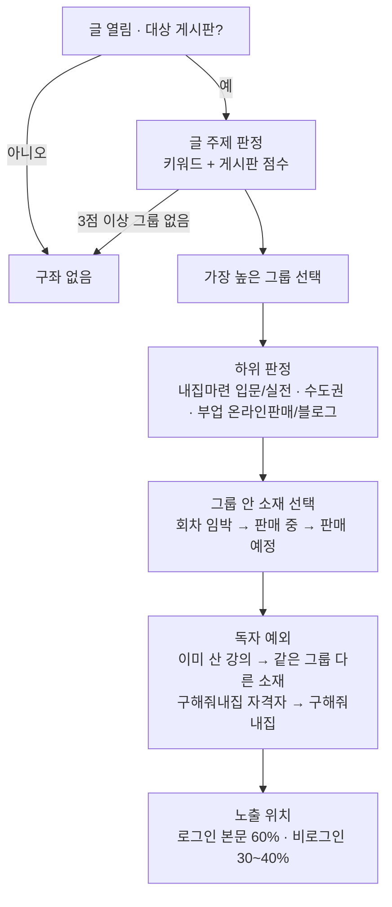

# 커뮤니티 본문 중간 개인화 배너

> 월부닷컴 · 2026.08 ~ 2026.11 · PD (기획 · 성과 분석)
> 5인 스쿼드(PO · PD · BE · FE · QA)에서 3차례 이터레이션 기획과 매 차수 성과 분석을 맡음

## 요약

- 재테크 교육 플랫폼의 커뮤니티 글 본문 중간에, **지금 읽는 글과 이어지는 강의**를 보여주는 개인화 구좌를 만들었다.
- 매칭 기준을 「유저 이력」에서 「글 맥락」으로 바꾸고 비로그인까지 열어, 노출 유저를 2차 대비 **14배** 넓혔다.
- 3차에서 배너 강의 **직접 매출이 2차 대비 2.2배**(일평균 2.8배), 클릭 후 7일 **전체 구매 매출은 4.9배**로 늘었다.

## 문제

- 커뮤니티는 서비스에서 트래픽이 가장 큰 자산인데, 글 상세의 기존 배너는 반응이 거의 없었다(하단 배너 클릭률 0.5%).
- 배너가 글 내용과 관계없이 고정돼 있어 「글과 무관한 광고」라는 VOC가 있었다.
- 가설: 글을 읽은 독자에게 **글 맥락에 맞는 제안**을 본문 중간에 보여주면 강의 상세 유입 · 오픈알림 · 구매가 늘어난다.

## 내가 한 일

- **소재 확대 기획 (2차)**: 주력 강의 소재를 추가하고, 소재별 이벤트 값과 성과 대시보드를 설계해 소재 단위로 성과를 볼 수 있게 함
- **3차 소재 · 노출 기획**: 월별 주력 강의 소재 기획, 실전 단계 소재를 주력 강의로 교체, 성공기 게시판 4개 카테고리로 노출 범위 확대
- **성과 분석 · 복기**: 매 차수 Amplitude 퍼널과 BigQuery 결제 연결로 「해당 상품 / 경유」 전환을 나눠 측정하고 다음 이터레이션 근거로 정리
- **운영 이슈 대응**: 판정 로직(글 키워드 · 게시판 점수) 기준으로 「왜 이 배너가 떴는지」 문의를 PRD 근거로 설명
- **후속 기획**: 배너 4개 지면을 한 화면에서 운영하는 어드민 고도화 기획(현행 어드민 실측 → 구조 · 시안 · 단계 · 개발 확인 사항, 아래 「후속 기획」)

## 이터레이션

| 차수 | 무엇을 바꿨나 | 노출 대상 |
| --- | --- | --- |
| 1차 | 본문 중간 개인화 구좌 신설. 유저 세그먼트(구매 이력 · 상세 조회 · 성공기 열람)로 소재 결정 | 로그인 · A/B |
| 2차 | 강의 상세 조회 이력 매칭, 주력 강의 5종 추가 | 로그인 · A/B |
| **3차** | **매칭 기준을 유저 → 글로 전환**. 글 키워드 · 게시판 점수로 주제를 판정하고 그 주제의 강의를 노출. 유저 조건은 「이미 산 강의 제외」만 남기고 **비로그인 확장**. 강의 회차 일정(회차 임박 → 판매 중 → 판매 예정)으로 소재 자동 선택 | 로그인 + 비로그인 · 전체 |
| 3차 보완 | 실전 단계 소재를 월 주력 강의로 교체, 성공기 게시판 7곳 추가(게시판 주제 기본 점수), 부업 하위 주제 분리 | |

## 로직 설계 (3차 글 맥락 매칭)

글을 열면 아래 순서로 배너 1개를 정한다. 독자 정보는 마지막 예외 처리에만 쓴다.

### 1. 글 주제 판정 — 점수제

- 글의 제목 · 태그 · 본문 앞부분에서 그룹별 키워드 점수를 더한다: 핵심어 +3 · 관련어 +2 · 주변어 +1 · 다른 주제 신호어 −3.
- 게시판 점수를 더한다. 예: 성공기 게시판은 게시판이 속한 주제에 기본 +3(키워드가 없어도 주제 판정), 내집마련성공기 · 내집마련 보고서는 내집마련으로 고정, 실전투자경험은 부동산 투자 +1.
- **3점 이상이면서 가장 높은 그룹**이 글의 주제. 어느 그룹도 3점이 안 되면 배너를 띄우지 않는다(억지 매칭 방지).
- 그룹 6개: 내집마련 · 부동산 투자(하위 수도권) · 종잣돈 · 재테크 · 미국주식 · 부업(하위 온라인 판매 / 블로그).

### 2. 하위 판정

- 내집마련: 입문 키워드(초보 · 첫집 · 언제 사야…) vs 실전 키워드(임장 · 가계약 · 잔금…) 점수 비교.
- 수도권 투자: 부동산 투자 3점 이상 + 글 지역이 서울 · 경기 · 인천이거나 수도권 키워드.
- 부업: ① 글에 연결된 작성자 수강 강의 → ② 온라인 판매 vs 블로그 키워드 → ③ 동점이면 열람마다 두 라인을 번갈아. 회차 일정만으로 고르니 오픈일이 하루 빠른 강의가 모든 부업 글을 가져가던 문제를 이렇게 풀었다.

### 3. 그룹 안 소재 선택 — 회차 일정 기준

- 회차 임박(본신청 7일 전 ~ 판매 종료) → 판매 중 → 판매 예정 순. 같은 상태면 오픈이 빠른 강의.
- 판매가 끝나 기수가 없는 강의는 후보에서 자동으로 빠진다(운영자 수동 교체 불필요).

### 4. 독자 예외 — 유저 조건은 2개만

- 로그인 독자가 이미 산 강의(최근 3개월)는 같은 그룹의 다른 소재로 바꾼다.
- 최근 3개월 안에 내집마련 강의 3종 중 하나를 산 독자가 내집마련 글을 보면 강의 대신 **중개 서비스(구해줘내집)**를 보여준다. 비로그인에게는 노출하지 않는다.

### 5. 노출 위치

- 로그인: 긴 글 본문 60% 지점. 비로그인: 로그인월이 뜨기 전인 30~40% 지점. 짧은 글은 본문 끝(기존 하단 구좌가 비어 있을 때만).
- 문장 · 이미지 · 표를 가르지 않는 위치에만 넣는다.

### 6. 측정 설계

- 노출 · 클릭 이벤트에 소재 값(`materialType`) · 상품 · 로그인 여부 · 노출 위치를 기록해 소재 단위로 성과를 본다.
- 전환은 두 갈래로 나눈다: 해당 상품(배너 강의 자체) / 경유(클릭 후 7일 안 아무 강의). 매출은 결제 데이터와 회원 단위로 연결하고 결제 직전 마지막 클릭 소재에 귀속.

### 설계 포인트

- 1 · 2차의 유저 세그먼트(구매 이력 · 상세 조회 · 성공기 열람) 방식은 대상이 로그인 · 이력 보유자로 좁고, 「글과 무관한 배너」가 나갔다. **「누가 읽나」보다 「무엇을 읽나」**를 기준으로 바꾸면서 비로그인까지 같은 로직으로 다룰 수 있게 됐다.
- 판정은 키워드 사전 + 게시판 점수로 단순하게 두고, 3점 합격선으로 애매한 글은 버린다(정확도 > 커버리지).
- 소재 선택을 강의 회차 일정에 묶어, 판매 일정이 바뀌어도 로직이 알아서 따라가게 했다.

### 내가 설계 · 반영한 부분

- 2차 소재 확대와 소재별 이벤트 값(`materialType`) 정의
- 3차 소재 기획 초안(월 주력 강의 3종), 내집마련 실전 단계 소재를 주력 강의로 교체
- 성공기 게시판 4개 카테고리 추가와 「게시판 주제 기본 3점」 판정 방식 PRD 반영

## 결과

### 차수별 (2차 = 1.0 기준)

| 지표 | 1차 (26일) | 2차 (21일) | 3차 (16일) |
| --- | ---: | ---: | ---: |
| 노출 유저 | 0.6배 | 1.0 | **14.2배** |
| 클릭 유저 | 0.4배 | 1.0 | **7.6배** |
| 해당 상품 매출 (배너 강의 자체) | 0.5배 | 1.0 | **2.2배** |
| 해당 상품 매출 일평균 | 0.4배 | 1.0 | **2.8배** |
| 경유 매출 (클릭 후 7일 아무 강의) | 2.2배 | 1.0 | **4.9배** |

- 3차는 클릭률(3.4%)이 2차(6.4%)보다 낮지만, 노출 대상이 14배로 넓어져 전환 절대 규모가 커졌다.
- 3차를 4주(27일)로 늘려 보면 해당 상품 매출은 2차의 2.5배, 경유 매출은 6.8배.

### 3차에서 보인 것 (4주 기준)

- **주력 강의 집중이 통했다.** 해당 상품 매출의 86%가 주력 강의 2개(저평가 43% · 수도권중급 43%)에서 나왔다.
- **입문 강의가 상위 강의의 입구가 됐다.** 저평가 배너 클릭자의 경유 매출이 저평가 자체 매출의 4.3배. 상당수가 중급 · 실전반으로 넘어갔다.
- **경유 매출이 해당 상품 매출의 4.8배.** 배너가 해당 강의뿐 아니라 다른 강의 구매 동선의 시작점 역할을 했다.
- **비로그인은 매출보다 가입 · 오픈알림을 만든다.** 비로그인 클릭자의 4.7%가 7일 안에 가입. 구매 기여는 경유 매출의 2.6%로 아직 작다.
- **소재별 클릭률 편차가 크다.** 부업(블로그) 7.1% · 종잣돈 6.0% vs 저평가 1.5%. 노출 1위 소재의 클릭률이 가장 낮아 개선 여지가 가장 크다.

## 복기

### 잘된 점

- 유저 이력 매칭의 한계(좁은 대상 · 맥락 불일치 VOC)를 글 맥락 매칭으로 풀면서 대상과 전환 규모를 동시에 키웠다.
- 월 주력 강의에 소재를 집중해 매출이 나는 소재를 분명히 했다.
- 판매 종료 소재가 회차 일정 기준으로 자동으로 빠지도록 해 운영 부담을 줄였다.

### 아쉬운 점과 배운 것

- **증분을 증명하지 못했다.** 1 · 2차 A/B에서 증분이 통계적으로 확인되지 않았고 3차는 대조군이 없었다. 경유 매출에는 원래 살 사람이 섞여 있다. → 다음엔 처음부터 홀드아웃(5~10%)을 설계에 넣는다.
- **지표 정의를 먼저 고정해야 한다.** 차수마다 기간 경계 · 전환 정의(해당 상품 vs 경유, 이벤트 vs 결제 데이터)를 맞추는 데 시간이 많이 들었다. → 측정 정의를 문서로 먼저 합의하고 시작한다.
- **글 판정 오차.** 인스타 수익화 글에 블로그 부업 배너가 나가는 등 하위 주제 구분이 부족했다. → 키워드 그룹을 운영자가 직접 추가할 수 있게 어드민으로 옮기는 기획으로 이어짐.
- **1회성 구조.** 소재 · 그룹 연결이 코드에 있어 소재 교체마다 배포가 필요했다. → 배너 4개 지면 통합 어드민 고도화 기획.

## 후속 기획: 커뮤니티 배너 어드민 고도화 (2026-11, 검토 단계)

### 왜

- 개인화 배너는 소재 · 글 그룹 연결이 코드에 있어 소재 하나 바꿀 때도 개발 배포가 필요했다. 개발 리드도 「1회성 구조라 유지보수 쉬운 구조로 개선이 필요하다」고 짚었다.
- 커뮤니티 글 상세에는 배너 지면이 4개(게시판 목록 · 상세 최상단 · 본문 중간 개인화 · 본문 내 하단) 있는데, 어드민에서 관리되는 건 2개뿐이었다.

### 지금 어드민을 직접 실측해 찾은 문제

- 배너마다 게시판이 30개 넘게 쉼표로 나열돼, 어느 게시판에 무엇이 걸렸는지 거꾸로 찾기 어렵다.
- 강의를 URL로 직접 넣어 회차가 바뀌면 수동 교체, 판매가 끝나도 배너가 자동으로 안 내려간다.
- 상 · 하단 배너는 이미지 3장만 받아 문구 하나 바꿀 때도 이미지를 새로 만들어야 한다.
- 성과(노출 · 클릭) 열과 미리보기가 없다.
- 문서상 규칙(목록 배너 노출 2일 제한)과 실제 운영 중 배너가 어긋나는 지점도 확인해 확인 요청 항목으로 올렸다.

### 제안한 구조

- 기존 어드민의 탭 · 모듈 틀은 그대로 두고, 모듈을 **지면 4개**로 바꾼다.
- 본문 중간 개인화 지면에 하위 탭 5개:

| 탭 | 내용 |
| --- | --- |
| **소재** | 강의만 고르면 기수 · 상세 페이지 자동 연결, 회차로 상태 자동 계산(회차 임박 · 판매 중 · 판매 예정 · 판매 종료 자동 내림), 소재별 성과 열 |
| **규칙** | 글 그룹마다 후보 소재와 우선순위, 지금 실제로 나가는 소재 |
| **노출 현황** | 기간 · 로그인 여부별 노출 · 클릭 · 전환, 클릭이 몰린 글 |
| **키워드 사전** | 그룹별 키워드 점수와 게시판 기본 점수 수정, 저장 전 「판정이 바뀌는 글」 미리보기 |
| **실험** | 소재 문구 · 이미지 A/B와 홀드아웃(2차 범위) |

- 공통 **글별 배너 확인** — 글 링크를 넣으면 4개 지면에 지금 무엇이 나가는지 한 번에 보여준다. 「후기 글인데 왜 중간엔 강의 배너가 뜨나」 같은 운영 문의를 어드민에서 바로 확인하게 하려는 기능.

### 어떻게 만들었나

- 사내에서 공유된 배너 시스템 프로토타입을 출발점으로, 실제 어드민 화면을 직접 열어 목록 열 · 등록 항목 · 컴포넌트 값(버튼 · 표 · 상태 칩 · 다이얼로그)을 실측했다.
- 시안은 새 스타일을 만들지 않고 **기존 어드민 컴포넌트 값 그대로** 그려, 개발이 바로 비교할 수 있게 했다.
- 숫자는 실제 3차 실적으로 채우고, 가상 값은 「예시」로 표시했다.
- 단계를 1차(운영 기능: 지면 통합 · 소재 테이블화 · 강의 연동 · 성과 · 미리보기 · 변경 이력)와 2차(A/B 실험 · 키워드 그룹 추가)로 나누고, 개발 확인 사항 11개와 의사결정 항목 5개(범위 · 성과 기준 실시간/전일 · 긴급 끄기 지연 허용 · 노출 기간 제한 · 권한)를 정리했다.

### 연결되는 효과

- 성과 분석에서 나온 다음 과제(저평가 소재 A/B, 인스타 수익화 소재 분리, 월 주력 소재 교체)를 개발 배포 없이 운영에서 바로 할 수 있게 된다.
- 개인화 배너를 일회성 실험에서 **상시 운영하는 시스템**으로 바꾸는 단계.

## 측정 기준

- 노출 · 클릭 · 오픈알림: Amplitude 유저 수, 임직원 제외, 전환 창 클릭 후 7일
- 매출: 배너 클릭을 결제 데이터와 회원 단위로 연결, 결제 직전 마지막 클릭 소재에 귀속(환불 포함)
- 해당 상품 = 배너 강의 자체 / 경유 = 클릭 후 7일 안 어떤 강의든
- 3차 16일 = 10/20~11/4 확정치, 4주 = 10/20~11/15 (2026-11-16 조회)
- 사내 매출 금액은 공개하지 않고 배수 · 비율로만 표기
